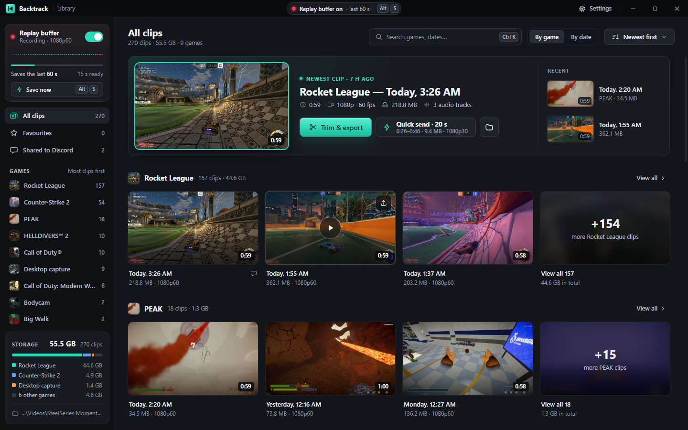

# Backtrack



**A free, open-source alternative to SteelSeries GG Moments.** Backtrack records the last minute of your game in the background. Press **Alt+S** and that moment is saved as a clip. Trim it, press **E**, and a Discord-sized copy (under 10 MB, no Nitro needed) is on your clipboard, ready to paste.

Everything runs on your PC. There's no account, no cloud and no telemetry.

## What it does

- **Replay buffer.** It keeps the last 60 seconds (or up to 5 minutes) in memory and records on your GPU, so it costs about 1% CPU.
- **Three audio tracks, like GG.** You get game audio, voice chat (Discord) and your mic, each on its own track, so you can turn any of them down or off later.
- **A simple trim editor.** It has a waveform for each track, markers and smooth timeline scrubbing.
- **Discord-ready export.** It picks the best resolution and frame rate that fits 10 MB (or Nitro's 50 / 500 MB, or any size you like) and copies the file to your clipboard.
- **Clean up in bulk.** Select clips with a click on their corner, Ctrl/Shift+click or a game's **Select all**, then move them all to the Recycle Bin at once, with Undo. It checks first that the Recycle Bin can actually keep them.
- **Works with your GG clips.** Point it at your SteelSeries Moments folder and it picks up game names, trims and the separate audio tracks.
- **Hotkeys, a tray icon and a small "clip saved" pop-up.** It can also start with Windows.

## Install

Download **`backtrack-…-setup.exe`** from the [latest release](https://github.com/kyle-barth/backtrack/releases/latest) and run it. That's it: FFmpeg comes included, and it installs just for you, with no admin rights needed.

<details>
<summary>Prefer a portable copy?</summary>

Unzip `backtrack-…-windows-x64.zip` anywhere, install FFmpeg yourself, then run `backtrack.exe`:

```powershell
winget install Gyan.FFmpeg.Essentials
```

Backtrack also finds `ffmpeg.exe` and `ffprobe.exe` in an `ffmpeg` folder next to it, or on your PATH.
</details>

Backtrack needs **Windows 11 (64-bit)**. It has been tested on AMD graphics; NVIDIA (NVENC) and CPU-only recording are built in but have had less testing, so reports are welcome. The app isn't code-signed yet, so Windows may warn you the first time: choose **More info → Run anyway**.

> Coming from GG? Turn off GG's Moments recording (or its Alt+S hotkey) so the two apps don't fight over the same key.

## Hotkeys

| Keys | What it does |
|---|---|
| **Alt+S** | Save the replay buffer as a clip |
| Alt+F9 | Turn the replay buffer on or off |
| Alt+F8 | Mute your mic in recordings |
| Alt+F7 | Mark a moment |
| Ctrl+Alt+B | Open Backtrack |

You can change all of these in Settings.

## Build it yourself

You need Rust (stable, MSVC) and the Visual Studio Build Tools. Then:

```powershell
cd src-tauri
cargo run
```

[DEVELOPMENT.md](DEVELOPMENT.md) explains how it all fits together.

## Contributing

Bug reports, ideas and pull requests are all welcome. Please open an issue first for anything big.

## License

[MIT](LICENSE)

The installer also includes [FFmpeg](https://ffmpeg.org), which is licensed under the GPLv3. Backtrack runs it as a separate program. Its licence, build details and links to its source are installed in the `ffmpeg` folder next to `backtrack.exe`.

---

Backtrack is an independent project and isn't affiliated with or endorsed by SteelSeries. SteelSeries and SteelSeries GG are trademarks of SteelSeries ApS.
